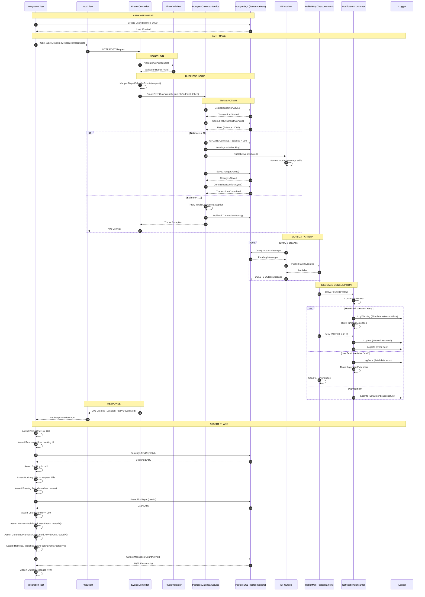
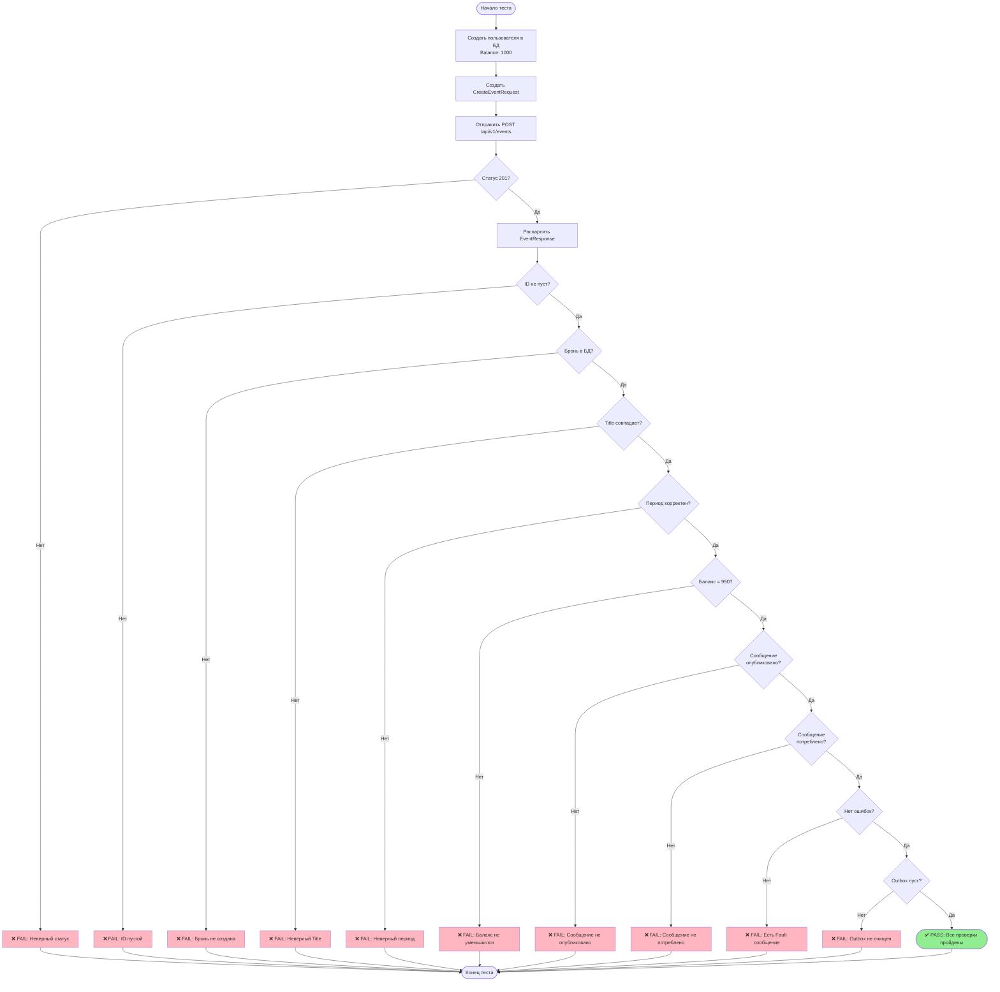
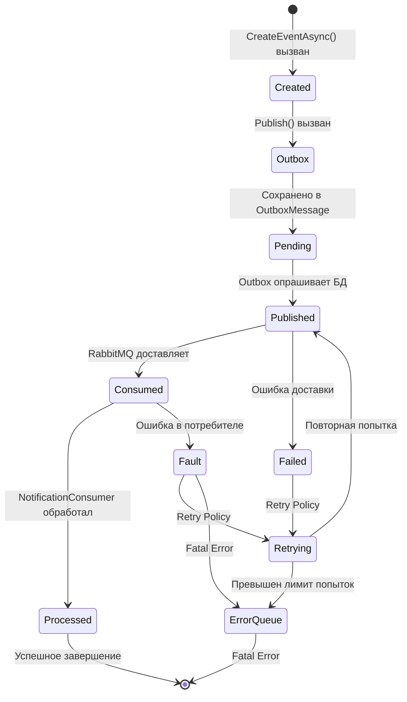
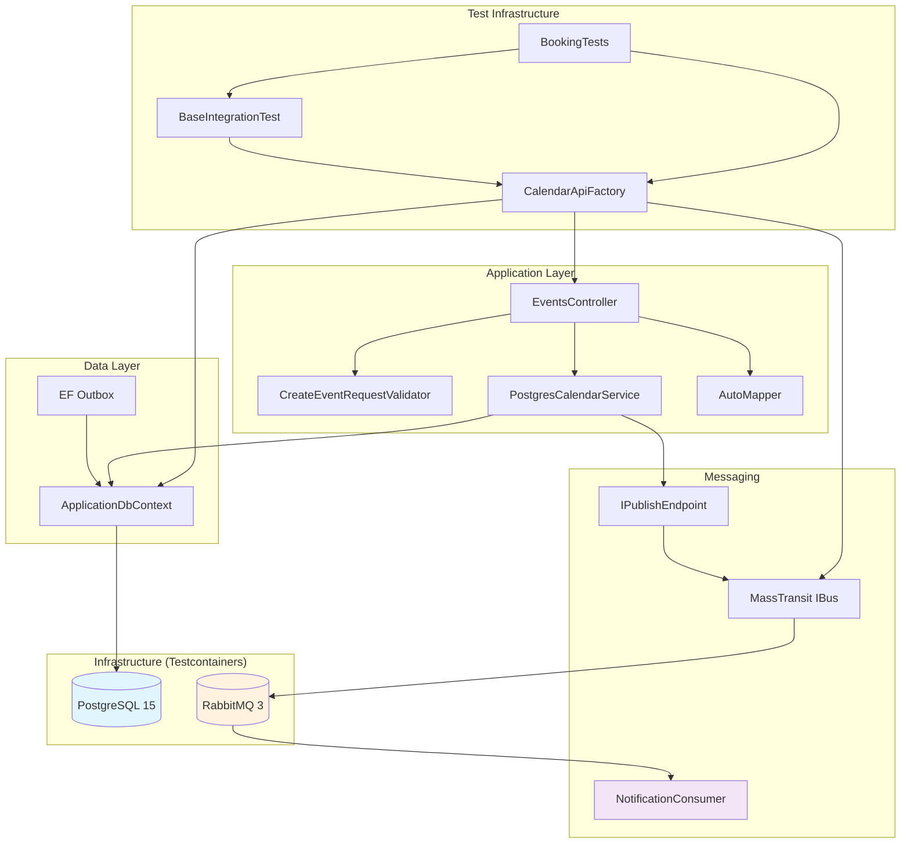

# План реализации комплексного E2E теста для создания события

## Обзор задачи

Необходимо добавить тест в [`tests/Calendar.IntegrationTests/BookingTests.cs`](tests/Calendar.IntegrationTests/BookingTests.cs), который проверяет полный цикл:
1. Клиент отправляет запрос на создание события
2. Событие записывается в базу данных
3. API возвращает положительный результат (201 Created)
4. Сообщение отправляется в шину сообщений (RabbitMQ)
5. Потребитель (NotificationConsumer) потребляет и обрабатывает сообщение

Все компоненты должны быть протестированы на реальных образах (Testcontainers).

---

## Визуализация тестового сценария

### Sequence Diagram - Полный цикл создания события



### Flowchart - Логика теста



### State Diagram - Состояния сообщения



### Component Diagram - Архитектура теста



---

## Анализ текущего состояния

### Существующий тест: `Post_Should_ReturnsCreatedAndResistInDb_When_PostBookingEvent()`

```csharp
[Fact]
public async Task Post_Should_ReturnsCreatedAndResistInDb_When_PostBookingEvent()
{
    // Arrange
    var user = await CreateUserInDbAsync();
    var createEventRequest = new CreateEventRequest(
        Title: "Team Meeting",
        Description: "Weekly sync-up with the team",
        StartTime: DateTimeOffset.UtcNow.AddDays(1),
        Duration: TimeSpan.FromHours(1),
        Location: "Conference Room A",
        RecurrentRule: null,
        UserId: user.Id);

    // Act
    var response = await Client.PostAsJsonAsync("/api/v1/events", createEventRequest);

    // Assert
    Assert.Equal(System.Net.HttpStatusCode.Created, response.StatusCode);

    var bookingInDb = DbContext.Bookings.FirstOrDefault(b => b.UserId == user.Id);
    Assert.NotNull(bookingInDb);

    var consumed = await Harness.Sent.Any<EventCreated>(x => x.Context.Message.UserId == user.Id);
    Assert.True(consumed, "Сообщение EventCreated не было потреблено");
}
```

### Компоненты системы

| Компонент | Файл | Роль |
|-----------|------|------|
| **Контроллер** | [`src/Calendar/Controllers/EventsController.cs`](src/Calendar/Controllers/EventsController.cs:31-54) | Обрабатывает HTTP запрос |
| **Сервис** | [`src/Calendar/Services/PostgresCalendarService.cs`](src/Calendar/Services/PostgresCalendarService.cs:14-79) | Бизнес-логика и транзакции |
| **БД** | PostgreSQL (Testcontainers) | Хранение данных |
| **Outbox** | EF Core Outbox | Гарантированная доставка сообщений |
| **Шина сообщений** | RabbitMQ (Testcontainers) | Транспорт сообщений |
| **Потребитель** | [`src/NotificationService/NotificationConsumer.cs`](src/NotificationService/NotificationConsumer.cs:6-47) | Обработка событий |

---

## Обнаруженные проблемы в текущем тесте

### 🔴 Критические проблемы

#### 1. Неверная проверка отправки сообщения
**Проблема:** Тест использует `Harness.Sent.Any<EventCreated>()`, но это проверяет только то, что сообщение было отправлено в шину, а не то, что оно было потреблено.

```csharp
// ❌ Текущий код
var consumed = await Harness.Sent.Any<EventCreated>(x => x.Context.Message.UserId == user.Id);
Assert.True(consumed, "Сообщение EventCreated не было потреблено");
```

**Почему это проблема:**
- `Harness.Sent` проверяет только отправку сообщения в шину
- Не гарантирует, что потребитель получил и обработал сообщение
- Не проверяет, что Outbox паттерн сработал корректно

**Как должно быть:**
```csharp
// ✅ Правильная проверка
// 1. Проверяем, что сообщение попало в шину
var sent = await Harness.Published.Any<EventCreated>(x => x.Context.Message.UserId == user.Id);
sent.Should().BeTrue("Сообщение EventCreated не было опубликовано в шину");

// 2. Проверяем, что потребитель получил сообщение
var consumerHarness = Harness.GetConsumerHarness<NotificationConsumer>();
var consumed = await consumerHarness.Consumed.Any<EventCreated>(x => x.Context.Message.UserId == user.Id);
consumed.Should().BeTrue("Потребитель NotificationConsumer не обработал сообщение");
```

#### 2. Отсутствие регистрации потребителя в тестовом харнесе
**Проблема:** В [`CalendarApiFactory.cs`](tests/Calendar.IntegrationTests/CalendarApiFactory.cs:63-83) не зарегистрирован `NotificationConsumer`.

```csharp
// ❌ Текущая конфигурация
services.AddMassTransitTestHarness(x =>
{
    x.SetKebabCaseEndpointNameFormatter();
    x.AddEntityFrameworkOutbox<ApplicationDbContext>(o => { ... });
    x.UsingInMemory((context, cfg) => { ... });
    // ❌ Отсутствует: x.AddConsumer<NotificationConsumer>();
});
```

**Почему это проблема:**
- Тест не может проверить потребление сообщения
- ConsumerHarness будет null при попытке получить его
- Нельзя проверить реальную обработку сообщения

**Как должно быть:**
```csharp
// ✅ Правильная конфигурация
services.AddMassTransitTestHarness(x =>
{
    x.SetKebabCaseEndpointNameFormatter();
    
    // Добавляем потребителя
    x.AddConsumer<NotificationConsumer>();
    
    x.AddEntityFrameworkOutbox<ApplicationDbContext>(o => { ... });
    x.UsingInMemory((context, cfg) => { ... });
});
```

#### 3. Использование InMemory вместо реального RabbitMQ
**Проблема:** Тест использует `UsingInMemory` для MassTransit вместо реального RabbitMQ контейнера.

```csharp
// ❌ Текущая конфигурация
x.UsingInMemory((context, cfg) =>
{
    cfg.ConfigureEndpoints(context);
});
```

**Почему это проблема:**
- Не тестирует реальный транспорт RabbitMQ
- Не проверяет сериализацию/десериализацию сообщений
- Не проверяет конфигурацию соединения с RabbitMQ
- Не соответствует требованию "на реальных образах"

**Как должно быть:**
```csharp
// ✅ Правильная конфигурация с RabbitMQ Testcontainers
// В CalendarApiFactory добавить:
private readonly RabbitMqContainer _rabbitMqContainer = new RabbitMqBuilder()
    .WithImage("rabbitmq:3-management")
    .WithUsername("guest")
    .WithPassword("guest")
    .Build();

// В ConfigureWebHost:
x.UsingRabbitMq((context, cfg) =>
{
    cfg.Host(_rabbitMqContainer.GetConnectionString());
    cfg.ConfigureEndpoints(context);
});
```

### 🟡 Средние проблемы

#### 4. Отсутствие проверки баланса пользователя
**Проблема:** Тест не проверяет, что баланс пользователя уменьшился после создания события.

**Почему это проблема:**
- [`PostgresCalendarService.CreateEventAsync()`](src/Calendar/Services/PostgresCalendarService.cs:30-35) списывает 10 единиц с баланса
- Это важная бизнес-логика, которая должна быть протестирована
- Транзакция может не сработать корректно

**Как должно быть:**
```csharp
// Проверка до создания
var userBefore = await DbContext.Users.AsNoTracking().FirstAsync(u => u.Id == user.Id);
var initialBalance = userBefore.Balance;

// ... создание события ...

// Проверка после создания
var userAfter = await DbContext.Users.AsNoTracking().FirstAsync(u => u.Id == user.Id);
userAfter.Balance.Should().Be(initialBalance - 10, "Баланс должен уменьшиться на 10");
```

#### 5. Отсутствие проверки Outbox паттерна
**Проблема:** Тест не проверяет, что сообщение корректно прошло через Outbox.

**Почему это проблема:**
- Outbox гарантирует доставку сообщения даже при сбоях
- Сообщение может быть в Outbox таблице, но не отправлено
- Важно проверить полный цикл: Outbox → RabbitMQ → Consumer

**Как должно быть:**
```csharp
// Проверка Outbox таблиц
var outboxMessages = await DbContext.OutboxMessages.CountAsync();
outboxMessages.Should().BeGreaterThan(0, "Должны быть записи в Outbox");

// Проверка, что Outbox пуст после обработки (сообщения отправлены)
await Task.Delay(TimeSpan.FromSeconds(5)); // Ждем обработки Outbox
var outboxMessagesAfter = await DbContext.OutboxMessages.CountAsync();
outboxMessagesAfter.Should().Be(0, "Outbox должен быть очищен после отправки");
```

#### 6. Отсутствие проверки данных в ответе API
**Проблема:** Тест проверяет только статус-код, но не проверяет содержимое ответа.

**Почему это проблема:**
- API может вернуть 201, но с некорректными данными
- ID события в ответе может не совпадать с ID в БД
- Данные события могут быть искажены

**Как должно быть:**
```csharp
var response = await Client.PostAsJsonAsync("/api/v1/events", createEventRequest);
response.StatusCode.Should().Be(HttpStatusCode.Created);

var eventResponse = await response.Content.ReadFromJsonAsync<EventResponse>();
eventResponse.Should().NotBeNull();
eventResponse!.Id.Should().NotBeEmpty();
eventResponse.Title.Should().Be(createEventRequest.Title);

// Проверяем, что ID в ответе совпадает с ID в БД
var bookingInDb = await DbContext.Bookings.FindAsync(eventResponse.Id);
bookingInDb.Should().NotBeNull();
bookingInDb!.Title.Should().Be(createEventRequest.Title);
```

### 🟢 Незначительные проблемы

#### 7. Отсутствие FluentAssertions
**Проблема:** Тест использует `Assert.Equal` вместо более читаемых `FluentAssertions`.

**Почему это проблема:**
- Сообщения об ошибках менее информативны
- Код менее читаемый

**Как должно быть:**
```csharp
// Вместо Assert.Equal(HttpStatusCode.Created, response.StatusCode);
response.StatusCode.Should().Be(HttpStatusCode.Created);

// Вместо Assert.NotNull(bookingInDb);
bookingInDb.Should().NotBeNull();
```

#### 8. Отсутствие проверки уникальности ID
**Проблема:** Тест не проверяет, что созданное событие имеет уникальный ID.

**Как должно быть:**
```csharp
bookingInDb.Id.Should().NotBeEmpty();
bookingInDb.Id.Should().NotBe(Guid.Empty);
```

#### 9. Отсутствие проверки времени создания
**Проблема:** Тест не проверяет, что период события корректен.

**Как должно быть:**
```csharp
bookingInDb.Period.LowerBound.Should().BeCloseTo(createEventRequest.StartTime.UtcDateTime, TimeSpan.FromSeconds(1));
bookingInDb.Period.UpperBound.Should().BeCloseTo(
    createEventRequest.StartTime.UtcDateTime.Add(createEventRequest.Duration),
    TimeSpan.FromSeconds(1));
```

---

## План реализации

### Этап 1: Подготовка инфраструктуры

#### 1.1 Добавить RabbitMQ Testcontainer в CalendarApiFactory

```csharp
public class CalendarApiFactory : WebApplicationFactory<Program>, IAsyncLifetime
{
    private readonly PostgreSqlContainer _dbContainer = new PostgreSqlBuilder("postgres:15")
        .WithDatabase("CalendarDb_Test")
        .WithUsername("postgres")
        .WithPassword("test_password")
        .Build();

    // ✅ Добавить RabbitMQ контейнер
    private readonly RabbitMqContainer _rabbitMqContainer = new RabbitMqBuilder()
        .WithImage("rabbitmq:3-management")
        .WithUsername("guest")
        .WithPassword("guest")
        .Build();

    public new async Task DisposeAsync()
    {
        await Harness.Stop();
        await _rabbitMqContainer.StopAsync(); // ✅ Остановить RabbitMQ
        await _dbContainer.StopAsync();
    }

    public async Task InitializeAsync()
    {
        await _dbContainer.StartAsync();
        await _rabbitMqContainer.StartAsync(); // ✅ Запустить RabbitMQ
    }
}
```

#### 1.2 Обновить конфигурацию MassTransit

```csharp
services.AddMassTransitTestHarness(x =>
{
    x.SetKebabCaseEndpointNameFormatter();
    
    // ✅ Добавить потребителя
    x.AddConsumer<NotificationConsumer>();
    
    x.AddEntityFrameworkOutbox<ApplicationDbContext>(o =>
    {
        o.UsePostgres();
        o.UseBusOutbox();
        o.DuplicateDetectionWindow = TimeSpan.FromMinutes(30);
        o.QueryDelay = TimeSpan.FromSeconds(2);
        o.QueryMessageLimit = 100;
    });

    x.AddConfigureEndpointsCallback((context, name, cfg) =>
    {
        cfg.UseEntityFrameworkOutbox<ApplicationDbContext>(context);
    });
    
    // ✅ Использовать RabbitMQ вместо InMemory
    x.UsingRabbitMq((context, cfg) =>
    {
        cfg.Host(_rabbitMqContainer.GetConnectionString());
        cfg.ConfigureEndpoints(context);
    });
});
```

#### 1.3 Добавить необходимые зависимости

В [`tests/Calendar.IntegrationTests/Calendar.IntegrationTests.csproj`](tests/Calendar.IntegrationTests/Calendar.IntegrationTests.csproj) добавить:

```xml
<ItemGroup>
  <PackageReference Include="Testcontainers.RabbitMq" Version="3.9.0" />
  <PackageReference Include="FluentAssertions" Version="6.12.0" />
</ItemGroup>
```

### Этап 2: Реализация теста

#### 2.1 Создать новый метод теста

```csharp
[Fact]
public async Task Post_Should_CreateEvent_SendToRabbitMQ_And_ConsumeByNotificationConsumer()
{
    // Arrange
    var user = await CreateUserInDbAsync();
    var initialBalance = user.Balance;
    
    var createEventRequest = new CreateEventRequest(
        Title: "Team Meeting",
        Description: "Weekly sync-up with the team",
        StartTime: DateTimeOffset.UtcNow.AddDays(1),
        Duration: TimeSpan.FromHours(1),
        Location: "Conference Room A",
        RecurrentRule: null,
        UserId: user.Id);

    // Act
    var response = await Client.PostAsJsonAsync("/api/v1/events", createEventRequest);

    // Assert - HTTP Level
    response.StatusCode.Should().Be(HttpStatusCode.Created);
    
    var eventResponse = await response.Content.ReadFromJsonAsync<EventResponse>();
    eventResponse.Should().NotBeNull();
    eventResponse!.Id.Should().NotBeEmpty();
    eventResponse.Title.Should().Be(createEventRequest.Title);

    // Assert - Database Level
    var bookingInDb = await DbContext.Bookings
        .Include(b => b.User)
        .FirstOrDefaultAsync(b => b.Id == eventResponse.Id);
    
    bookingInDb.Should().NotBeNull("Бронирование должно быть сохранено в БД");
    bookingInDb!.Title.Should().Be(createEventRequest.Title);
    bookingInDb.UserId.Should().Be(user.Id);
    bookingInDb.Period.LowerBound.Should().BeCloseTo(
        createEventRequest.StartTime.UtcDateTime, 
        TimeSpan.FromSeconds(1));
    bookingInDb.Period.UpperBound.Should().BeCloseTo(
        createEventRequest.StartTime.UtcDateTime.Add(createEventRequest.Duration),
        TimeSpan.FromSeconds(1));

    // Assert - User Balance
    var userAfter = await DbContext.Users.AsNoTracking().FirstAsync(u => u.Id == user.Id);
    userAfter.Balance.Should().Be(initialBalance - 10, "Баланс должен уменьшиться на 10");

    // Assert - Message Bus Level
    // 1. Проверяем, что сообщение было опубликовано
    var published = await Harness.Published.Any<EventCreated>(
        x => x.Context.Message.EventId == eventResponse.Id);
    published.Should().BeTrue("Сообщение EventCreated должно быть опубликовано в шину");

    // 2. Проверяем, что потребитель получил сообщение
    var consumerHarness = Harness.GetConsumerHarness<NotificationConsumer>();
    var consumed = await consumerHarness.Consumed.Any<EventCreated>(
        x => x.Context.Message.EventId == eventResponse.Id);
    consumed.Should().BeTrue("Потребитель NotificationConsumer должен обработать сообщение");

    // 3. Проверяем, что не было ошибок
    var faulted = await Harness.Published.Any<Fault<EventCreated>>(
        x => x.Context.Message.Message.EventId == eventResponse.Id);
    faulted.Should().BeFalse("Не должно быть ошибок при обработке сообщения");

    // Assert - Outbox Level
    // Проверяем, что Outbox пуст после обработки
    await Task.Delay(TimeSpan.FromSeconds(5)); // Ждем обработки Outbox
    var outboxMessages = await DbContext.OutboxMessages.CountAsync();
    outboxMessages.Should().Be(0, "Outbox должен быть очищен после отправки сообщений");
}
```

### Этап 3: Дополнительные тесты (опционально)

#### 3.1 Тест для проверки retry policy

```csharp
[Fact]
public async Task Post_Should_Retry_When_NotificationConsumerFails()
{
    // Arrange
    var user = await CreateUserInDbAsync();
    user.Email = "retry@test.com"; // Триггер retry в NotificationConsumer
    await DbContext.SaveChangesAsync();
    
    var createEventRequest = new CreateEventRequest(
        Title: "Retry Test Event",
        Description: "Test retry policy",
        StartTime: DateTimeOffset.UtcNow.AddDays(1),
        Duration: TimeSpan.FromHours(1),
        Location: "Test Room",
        RecurrentRule: null,
        UserId: user.Id);

    // Act
    var response = await Client.PostAsJsonAsync("/api/v1/events", createEventRequest);

    // Assert
    response.StatusCode.Should().Be(HttpStatusCode.Created);
    
    var consumerHarness = Harness.GetConsumerHarness<NotificationConsumer>();
    
    // Проверяем, что сообщение было потреблено несколько раз (retry)
    var consumedCount = await consumerHarness.Consumed.SelectAsync<EventCreated>().Count();
    consumedCount.Should().BeGreaterThan(1, "Должны быть retry попытки");
}
```

#### 3.2 Тест для проверки fatal error

```csharp
[Fact]
public async Task Post_Should_SendToErrorQueue_When_NotificationConsumerThrowsFatalError()
{
    // Arrange
    var user = await CreateUserInDbAsync();
    user.Email = "fatal@test.com"; // Триггер fatal error в NotificationConsumer
    await DbContext.SaveChangesAsync();
    
    var createEventRequest = new CreateEventRequest(
        Title: "Fatal Error Test Event",
        Description: "Test fatal error handling",
        StartTime: DateTimeOffset.UtcNow.AddDays(1),
        Duration: TimeSpan.FromHours(1),
        Location: "Test Room",
        RecurrentRule: null,
        UserId: user.Id);

    // Act
    var response = await Client.PostAsJsonAsync("/api/v1/events", createEventRequest);

    // Assert
    response.StatusCode.Should().Be(HttpStatusCode.Created);
    
    // Проверяем, что Fault сообщение было отправлено
    var faulted = await Harness.Published.Any<Fault<EventCreated>>(
        x => x.Context.Message.Message.UserId == user.Id);
    faulted.Should().BeTrue("Fault сообщение должно быть отправлено в _error очередь");
}
```

---

## Сравнение с существующим тестом

| Аспект | Существующий тест | Предлагаемый тест |
|--------|------------------|------------------|
| **Проверка HTTP статуса** | ✅ | ✅ |
| **Проверка данных в БД** | ✅ (частично) | ✅ (полно) |
| **Проверка баланса** | ❌ | ✅ |
| **Проверка отправки сообщения** | ❌ (неверно) | ✅ (верно) |
| **Проверка потребления сообщения** | ❌ | ✅ |
| **Проверка ошибок** | ❌ | ✅ |
| **Проверка Outbox** | ❌ | ✅ |
| **Использование RabbitMQ** | ❌ (InMemory) | ✅ (Testcontainers) |
| **Регистрация потребителя** | ❌ | ✅ |
| **FluentAssertions** | ❌ | ✅ |
| **Проверка ответа API** | ❌ | ✅ |
| **Проверка периода события** | ❌ | ✅ |

---

## Резюме

### Критические исправления (обязательны)

1. ✅ Заменить `Harness.Sent` на `Harness.Published` + проверку потребления
2. ✅ Зарегистрировать `NotificationConsumer` в тестовом харнесе
3. ✅ Заменить `UsingInMemory` на `UsingRabbitMq` с Testcontainers

### Важные улучшения (рекомендуются)

4. ✅ Добавить проверку баланса пользователя
5. ✅ Добавить проверку Outbox паттерна
6. ✅ Добавить проверку данных в ответе API

### Косметические улучшения (желательны)

7. ✅ Использовать FluentAssertions
8. ✅ Добавить проверку уникальности ID
9. ✅ Добавить проверку времени создания

---

## Следующие шаги

После утверждения плана:

1. Обновить [`CalendarApiFactory.cs`](tests/Calendar.IntegrationTests/CalendarApiFactory.cs) для поддержки RabbitMQ Testcontainers
2. Зарегистрировать `NotificationConsumer` в тестовом харнесе
3. Реализовать новый тестовый метод в [`BookingTests.cs`](tests/Calendar.IntegrationTests/BookingTests.cs)
4. Запустить тесты и убедиться, что все проходят
5. Добавить дополнительные тесты для edge cases (retry, fatal error)
