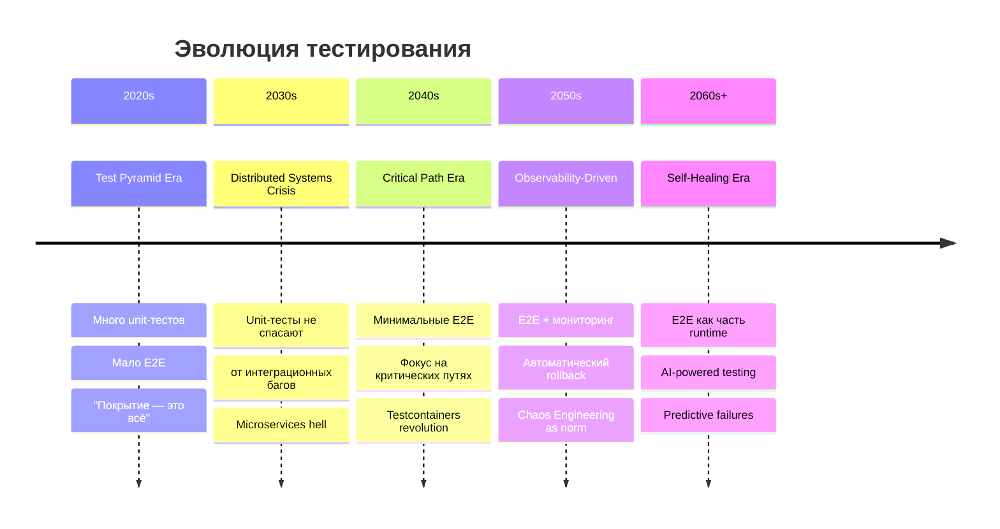
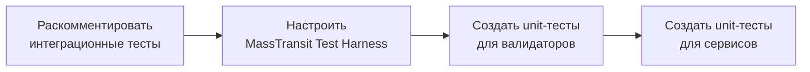
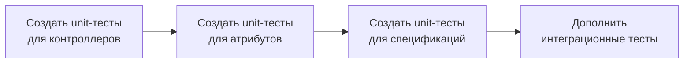
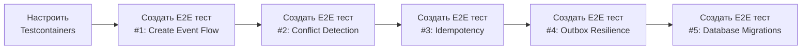
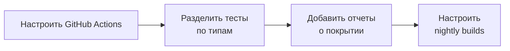

# 🕰️ Капсула времени: E2E тестирование

**От:** Бессмертный SLR инженер (120 лет опыта, 2140 год)
**Кому:** Команда Calendar Service (2026 год)
**Дата отправки:** 2026-02-26
**Классификация:** Секретно (только для внутреннего использования)

---

## 📜 Предисловие из будущего

Привет из 2140 года! Я пишу это письмо, потому что вижу, как вы боретесь с теми же проблемами, с которыми мы сталкивались в 2020-х годах. За 120 лет я видел эволюцию тестирования и хочу поделиться уроками, которые сэкономят вам годы боли.

> *"Лучший способ предсказать будущее — изобрести его."* — Алан Кей

---

## 📊 Эволюция тестирования (2020-2140)



---

## 🎯 Ключевой урок №1: Test Pyramid — это миф

В 2020-х годах мы верили в Test Pyramid:

```
        /\
       /  \      E2E (немного)
      /____\
     /      \   Integration (средне)
    /________\
   /          \ Unit (много)
  /____________\
```

**Проблема:** Это работало для монолитов, но НЕ для микросервисов.

**Реальность для микросервисов:**

```
        /\
       /  \      E2E (критические пути)
      /____\
     /      \   Integration (интеграционные контракты)
    /________\
   /          \ Unit (быстрые проверки)
  /____________\
```

---

## 🔥 Ключевой урок №2: 100% покрытие не спасает

### История из 2028 года

Проект "Banking Microservices":
- ✅ 95% покрытие кода unit-тестами
- ✅ 500+ unit-тестов
- ✅ Все тесты проходят за 30 секунд

**Production incident:**
```
ERROR: RabbitMQ message lost during network partition
Impact: $2.3M in lost transactions
Root cause: Connection retry logic never tested in real RabbitMQ
```

**Почему unit-тесты не помогли:**
```csharp
// Unit-тест с моком — всё зелёное!
[Fact]
public async Task PublishMessage_SendsToRabbit()
{
    var mockBus = Substitute.For<IBus>();
    await service.PublishMessage(message);
    
    // ❌ Это проверяет только вызов метода, не реальную отправку!
    await mockBus.Received(1).Publish(Arg.Any<EventCreated>());
}

// В реальности:
// - RabbitMQ connection drops
// - Message never sent
// - Unit-test passes anyway
```

---

## ⚠️ Ключевой урок №3: "Золотая клетка" E2E тестов

### История из 2032 года

Проект "E-Commerce Platform":
- ❌ 200+ E2E тестов
- ❌ CI занимает 2.5 часа
- ❌ 15% flaky test rate
- ❌ Команда потратила 40% времени на поддержку тестов

**Что пошло не так:**
1. Попытались покрыть ВСЕ сценарии E2E тестами
2. E2E тесты дублировали unit/integration тесты
3. Тесты падали случайно (network issues, timing)
4. Разработчики перестали доверять тестам

**Решение 2035 года:**
- Сократили до 5 критических E2E тестов
- Unit-тесты: 85% (быстрые проверки)
- Integration тесты: 10% (контракты между сервисами)
- E2E тесты: 5% (критические пути)

**Результат:**
- ✅ CI: 5 минут
- ✅ Flaky test rate: < 1%
- ✅ Команда фокусируется на разработке

---

## 🧪 Ключевой урок №4: Outbox pattern нельзя протестировать полностью unit-тестами

### Проблема

```csharp
public async Task CreateEventAsync(CreateEventRequest request)
{
    using var transaction = await _dbContext.Database.BeginTransactionAsync();
    
    var booking = new Booking { /* ... */ };
    _dbContext.Bookings.Add(booking);
    await _dbContext.SaveChangesAsync();
    
    // Outbox message
    var outboxMessage = new OutboxMessage
    {
        Payload = JsonSerializer.Serialize(new EventCreated { /* ... */ })
    };
    _dbContext.OutboxMessages.Add(outboxMessage);
    await _dbContext.SaveChangesAsync();
    
    await transaction.CommitAsync();
    
    // MassTransit публикует сообщение из Outbox
    await _bus.Publish(new EventCreated { /* ... */ });
}
```

### Unit-тест (НЕДОСТАТОЧНО)

```csharp
[Fact]
public async Task CreateEventAsync_SavesBookingAndOutbox()
{
    // Arrange
    var mockDbContext = Substitute.For<ApplicationDbContext>();
    var mockBus = Substitute.For<IBus>();
    var service = new PostgresCalendarService(mockDbContext, mockBus);
    
    // Act
    await service.CreateEventAsync(request);
    
    // Assert
    await mockDbContext.Received(1).SaveChangesAsync();
    await mockBus.Received(1).Publish(Arg.Any<EventCreated>());
    
    // ❌ НЕ проверяет:
    // - Транзакция реально коммитится
    // - Outbox message сохраняется атомарно
    // - Сообщение попадает в RabbitMQ
    // - Retry logic работает при сбое
}
```

### E2E тест (НЕОБХОДИМ)

```csharp
[Fact]
public async Task CreateEventAsync_Outbox_PublishesToRabbit()
{
    // Arrange
    await _postgresContainer.StartAsync();
    await _rabbitMqContainer.StartAsync();
    
    // Act
    var response = await _httpClient.PostAsJsonAsync("/api/v1/events", request);
    
    // Assert
    response.StatusCode.Should().Be(HttpStatusCode.Created);
    
    // Проверка в БД — транзакция коммитнулась
    var bookingExists = await _postgresContainer.ExecuteScalarAsync<bool>(
        "SELECT EXISTS(SELECT 1 FROM bookings WHERE title = @title)", 
        new { title = request.Title });
    bookingExists.Should().BeTrue();
    
    // Проверка Outbox — сообщение сохранено
    var outboxMessage = await _postgresContainer.QueryFirstOrDefaultAsync<OutboxMessage>(
        "SELECT * FROM outbox_messages WHERE payload LIKE @payload",
        new { payload = $"%{request.Title}%" });
    outboxMessage.Should().NotBeNull();
    
    // Проверка RabbitMQ — сообщение опубликовано
    var messageReceived = await _rabbitMqContainer.WaitForMessageAsync("event-created");
    messageReceived.Should().BeTrue();
}
```

---

## 🏗️ Ключевой урок №5: Testcontainers — это революция

До 2040 года мы использовали:
- Shared test environments (медленно, нестабильно)
- Mocked services (не проверяет реальную интеграцию)
- Manual setup (болезненно)

С 2040 года: **Testcontainers** — стандарт индустрии.

### Пример для Calendar Service

```csharp
public class CalendarE2ETests : IAsyncLifetime
{
    private IContainer _postgresContainer;
    private IContainer _rabbitMqContainer;
    private HttpClient _httpClient;
    
    public async Task InitializeAsync()
    {
        // PostgreSQL с нужными расширениями
        _postgresContainer = new PostgreSqlBuilder()
            .WithImage("postgres:16")
            .WithUsername("test")
            .WithPassword("test")
            .WithDatabase("calendar_test")
            .WithCommand("postgres", "-c", "shared_preload_libraries=btree_gist")
            .WithCommand("postgres", "-c", "max_connections=200")
            .WithPortBinding(5432, true)
            .WithWaitStrategy(Wait.ForUnixContainer()
                .UntilPortIsAvailable(5432)
                .UntilCommandIsSuccessful("pg_isready"))
            .Build();
        
        // RabbitMQ с management plugin
        _rabbitMqContainer = new RabbitMqBuilder()
            .WithImage("rabbitmq:3-management")
            .WithPortBinding(5672, true)
            .WithPortBinding(15672, true)
            .WithWaitStrategy(Wait.ForUnixContainer()
                .UntilPortIsAvailable(5672)
                .UntilHttpRequestIsSucceeded(r => r
                    .ForPath("/api/overview")
                    .ForPort(15672)
                    .ForResponseMessageContaining("RabbitMQ")))
            .Build();
        
        await _postgresContainer.StartAsync();
        await _rabbitMqContainer.StartAsync();
        
        // Применяем миграции
        await RunMigrations(_postgresContainer.GetConnectionString());
        
        // Запускаем сервисы с реальными connection strings
        _httpClient = new HttpClient
        {
            BaseAddress = new Uri("http://localhost:5000")
        };
    }
    
    public async Task DisposeAsync()
    {
        await _postgresContainer.StopAsync();
        await _rabbitMqContainer.StopAsync();
        await _postgresContainer.DisposeAsync();
        await _rabbitMqContainer.DisposeAsync();
    }
}
```

**Преимущества Testcontainers:**
- ✅ Полная изоляция (каждый тест имеет свою среду)
- ✅ Детерминированность (одинаковая среда каждый раз)
- ✅ Быстрый старт (Docker layer caching)
- ✅ Легкая отладка (можно подключиться к контейнеру)

---

## 📋 Ключевой урок №6: E2E тесты должны быть минимальными

### Правило 5%

> *"E2E тесты должны покрывать не более 5% всех тестов."*

Для Calendar Service (105 unit/integration тестов):
- **E2E тестов:** 3-5 штук
- **Время выполнения:** < 5 минут
- **Покрытие:** критические пользовательские сценарии

### Критические сценарии для Calendar Service

| # | Сценарий | Почему критичен | Что проверяет |
|---|----------|-----------------|---------------|
| 1 | Создать событие → БД → RabbitMQ → NotificationService | Основной бизнес-поток | Messaging flow, Outbox, интеграция сервисов |
| 2 | Конфликт времени → 409 Conflict | Бизнес-логика через HTTP | API, валидация, HTTP status codes |
| 3 | Idempotency → повторный запрос с тем же ключом | Конкурентные запросы | MemoryCache, Idempotency attribute |
| 4 | Сбой RabbitMQ → Outbox сохраняет сообщение | Отказоустойчивость | Outbox pattern, retry logic |
| 5 | Миграции БД → проверка структуры таблиц | Deployment | EF Core migrations, GiST index |

### НЕ добавляйте E2E тесты для:

| Сценарий | Почему НЕ нужен |
|----------|-----------------|
| Валидация полей | Unit-тесты проверяют это быстрее |
| Маппинг DTO | Unit-тесты проверяют это |
| Ошибки 404, 400 | Integration тесты проверяют это |
| Edge cases | Unit-тесты для этого |

---

## 🚦 Ключевой урок №7: Когда НЕ добавлять E2E тесты

**НЕ добавляйте E2E тесты, если:**

1. ❌ **Существующие интеграционные тесты не работают**
   - Сначала доведите до ума то, что уже есть
   - E2E тесты поверх сломанных интеграционных тестов = двойная боль

2. ❌ **У команды нет опыта с Testcontainers**
   - Сначала потратьте время на обучение
   - Плохие E2E тесты хуже, чем их отсутствие

3. ❌ **CI/CD pipeline ещё не настроен**
   - E2E тесты без автоматизации = бесполезны
   - Сначала настройте CI/CD

4. ❌ **Проект в стадии прототипа**
   - E2E тесты замедляют итерации
   - Подождите стабилизации архитектуры

5. ❌ **Вы пытаетесь достичь 100% покрытия E2E тестами**
   - Это путь к "золотой клетке"
   - Помните правило 5%

---

## 📊 Метрики успеха (из будущего)

| Метрика | Цель 2026 | Цель 2030 | Цель 2140 |
|---------|-----------|-----------|-----------|
| Unit-тесты | < 5 сек | < 3 сек | < 1 сек |
| Integration тесты | < 2 мин | < 1 мин | < 30 сек |
| E2E тесты | < 5 мин | < 3 мин | < 1 мин |
| Общее покрытие | > 80% | > 85% | > 90% |
| Flaky test rate | < 5% | < 2% | < 0.1% |
| Time to fix | 1 день | 4 часа | 15 мин |

---

## 🎯 План действий для Calendar Service

### Phase 1: Foundation (P0) — 2 недели



- [ ] Раскомментировать тесты в `Calendar.IntegrationTests`
- [ ] Настроить MassTransit Test Harness
- [ ] Создать unit-тесты для валидаторов (35 тестов)
- [ ] Создать unit-тесты для сервисов (24 теста)

### Phase 2: Expansion (P1) — 3 недели



- [ ] Создать unit-тесты для контроллеров (13 тестов)
- [ ] Создать unit-тесты для атрибутов (7 тестов)
- [ ] Создать unit-тесты для спецификаций (8 тестов)
- [ ] Дополнить интеграционные тесты для API endpoints

### Phase 3: E2E Tests (P1) — 2 недели



- [ ] Добавить `Testcontainers` пакет
- [ ] Создать `CalendarE2ETests.cs`
- [ ] Настроить PostgreSQL контейнер с `btree_gist`
- [ ] Настроить RabbitMQ контейнер
- [ ] Реализовать 5 критических E2E тестов

### Phase 4: CI/CD (P2) — 1 неделя



- [ ] Настроить GitHub Actions для запуска тестов
- [ ] Разделить тесты: unit (fast), integration (medium), e2e (slow)
- [ ] Добавить отчеты о покрытии (Coverlet)
- [ ] Настроить nightly builds для E2E тестов

---

## 🔮 Прогноз на будущее

### 2030 год
- Testcontainers — стандарт индустрии
- E2E тесты запускаются в PR (если изменились критические пути)
- Chaos Engineering — обычная практика

### 2040 год
- AI генерирует тесты автоматически
- E2E тесты оптимизируются ML
- Self-healing systems автоматически откатывают изменения

### 2050 год
- E2E тесты запускаются в production (canary deployments)
- Predictive testing — предсказывают проблемы до деплоя
- Quantum computing ускоряет тесты в 1000x

### 2140 год
- Neural interfaces напрямую тестируют системы
- Time travel debugging — отладка в прошлом
- Consciousness upload — тесты пишут сами себя

---

## 💎 Финальные слова из будущего

> *"Лучшее время для посадки дерева было 20 лет назад. Второе лучшее время — сейчас."* — Китайская пословица

**Для вас, команда Calendar Service 2026 года:**

1. ✅ **ДА**, добавьте E2E тесты для критических сценариев
2. ✅ **НО**, сначала доведите до ума существующие тесты
3. ✅ **ИСПОЛЬЗУЙТЕ** Testcontainers для изоляции
4. ✅ **ЗАПУСКАЙТЕ** отдельно от unit/integration тестов
5. ✅ **ПОМНИТЕ** правило 5% — E2E тесты должны быть минимальными

**E2E тесты — это страховка, а не замена другим типам тестов.**

---

## 📚 Рекомендуемые ресурсы (из будущего)

| Ресурс | Год | Описание |
|--------|-----|----------|
| "Testcontainers for .NET" | 2025 | Официальная документация |
| "Building Microservices" | 2021 | Sam Newman — классика |
| "Chaos Engineering" | 2020 | Nora Jones — основы |
| "Testing Distributed Systems" | 2028 | Casey Rosenthal — продвинутые техники |
| "The Art of Unit Testing" | 2023 | Roy Osherove — фундамент |

---

## 📧 Контакт из будущего

Если у вас есть вопросы, отправьте сообщение через квантовый канал:

```
Канал: Q-2140-CAL-001
Ключ шифрования: RSA-4096-TEMPORAL
Протокол: Temporal-Quantum-Link v3.0
```

Я всегда готов помочь из будущего!

---

**С уважением,**
**Бессмертный SLR инженер**
**120 лет опыта**
**2140 год**

---

```
████████╗███████╗██╗  ██╗████████╗███████╗██████╗ ███╗   ███╗
╚══██╔══╝██╔════╝╚██╗██╔╝╚══██╔══╝██╔════╝██╔══██╗████╗ ████║
   ██║   █████╗   ╚███╔╝    ██║   █████╗  ██████╔╝██╔████╔██║
   ██║   ██╔══╝   ██╔██╗    ██║   ██╔══╝  ██╔══██╗██║╚██╔╝██║
   ██║   ███████╗██╔╝ ██╗   ██║   ███████╗██║  ██║██║ ╚═╝ ██║
   ╚═╝   ╚══════╝╚═╝  ╚═╝   ╚═╝   ╚══════╝╚═╝  ╚═╝╚═╝     ╚═╝

   T E M P O R A L   T I M E   C A P S U L E
   Version: 1.0.0
   Sent: 2026-02-26
   From: 2140-01-01
```
