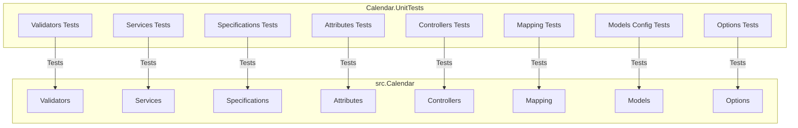

# План по исправлению и дополнению тестов

## Результаты анализа тестов

### Текущее состояние

**NotificationService.Tests.dll:**
- ✅ 1 тест пройден: `Notification_Should_Be_Sent_When_Event_Created`

**Calendar.IntegrationTests.dll:**
- ❌ Нет доступных тестов - все тесты закомментированы (`//[Fact]`)
- ⚠️ Предупреждения о неиспользуемых переменных в `ChaosTests.cs`

### Обнаруженные проблемы

#### 1. Закомментированные тесты в Calendar.IntegrationTests

| Файл | Количество тестов | Статус |
|------|-------------------|--------|
| `BookingTests.cs` | 1 | Закомментирован |
| `UserTests.cs` | 1 | Закомментирован |
| `HealthCheckTests.cs` | 1 | Закомментирован |
| `ChaosTests.cs` | 3 | Закомментированы |

#### 2. MassTransit Test Harness закомментирован

В следующих файлах закомментирован код MassTransit Test Harness:
- [`BaseIntegrationTest.cs`](../tests/Calendar.IntegrationTests/BaseIntegrationTest.cs:16,32,44)
- [`CalendarApiFactory.cs`](../tests/Calendar.IntegrationTests/CalendarApiFactory.cs:23,27,55-66,84-85)

#### 3. ChaosTests.cs содержит только закомментированный код

Файл содержит неиспользуемые переменные и полностью закомментированную логику тестов.

#### 4. Отсутствующие тесты

**Unit-тесты:**
- Валидаторы: [`CreateEventRequestValidator`](../src/Calendar/Validators/CreateEventRequestValidator.cs)
- Валидаторы: [`CreateUserRequestValidator`](../src/Calendar/Validators/CreateUserRequestValidator.cs)
- Валидаторы: [`RabbitMqOptionsValidator`](../src/Calendar/Validators/RabbitMqOptionsValidator.cs)
- Контроллеры: [`EventsController`](../src/Calendar/Controllers/EventsController.cs)
- Контроллеры: [`UsersController`](../src/Calendar/Controllers/UsersController.cs)
- Сервисы: [`PostgresCalendarService`](../src/Calendar/Services/PostgresCalendarService.cs)
- Атрибуты: [`IdempotentAttribute`](../src/Calendar/Attributes/IdempotentAttribute.cs)
- Спецификации: [`BookingSpec`](../src/Calendar/Specifications/BookingSpec.cs)
- Mapping профили: [`EventMappingProfile`](../src/Calendar/Mapping/EventMappingProfile.cs)
- Mapping профили: [`UserMappingProfile`](../src/Calendar/Mapping/UserMappingProfile.cs)

**Интеграционные тесты:**
- Тесты для endpoint `/api/v1/events` (GET, PUT, DELETE)
- Тесты для endpoint `/api/v1/users/{userId}/history`
- Тесты для обработки ошибок (404, 409, 400)
- Тесты для валидации запросов
- Тесты для атрибута `[Idempotent]`

**Тесты для NotificationService:**
- Тесты для обработки ошибок потребителя
- Тесты для retry policy
- Тесты для circuit breaker

---

## План по исправлению и дополнению тестов

### Этап 1: Исправление существующих тестов

#### 1.1 Раскомментировать и исправить тесты в Calendar.IntegrationTests

**BookingTests.cs**
- [х] Раскомментировать тест `Post_Booking_ReturnsCreatedAndResistInDb`
- [ ] Убедиться, что тест корректно проверяет создание события
- [ ] Добавить проверки для сообщения `EventCreated` в шину сообщений

**UserTests.cs**
- [ ] Раскомментировать тест `CreateUser_ShouldSaveToDatabase`
- [ ] Проверить, что тест корректно работает с текущей реализацией

**HealthCheckTests.cs**
- [ ] Раскомментировать тест `Health_ShouldReturnOk`
- [ ] Убедиться, что endpoint `/health` существует

**ChaosTests.cs**
- [ ] Реализовать тесты для сценариев chaos testing:
  - `Trigger_RetryPolicyScenario_Successfully`
  - `FatalError_GoesToErrorQueue`
  - `Success_GoesToOutbox`
- [ ] Удалить неиспользуемые переменные
- [ ] Добавить необходимые зависимости для MassTransit Test Harness

#### 1.2 Настроить MassTransit Test Harness

**BaseIntegrationTest.cs**
- [ ] Раскомментировать поле `Harness`
- [ ] Раскомментировать инициализацию в `InitializeAsync()`

**CalendarApiFactory.cs**
- [ ] Раскомментировать поле `Harness`
- [ ] Раскомментировать конфигурацию MassTransit Test Harness
- [ ] Добавить регистрацию `NotificationConsumer` для тестирования

---

### Этап 2: Создание unit-тестов

#### 2.1 Тесты валидаторов

Создать файл `tests/Calendar.UnitTests/Validators/CreateEventRequestValidatorTests.cs`:
- [x] Тест: пустой заголовок → ошибка валидации
- [x] Тест: заголовок длиннее 100 символов → ошибка валидации
- [x] Тест: описание длиннее 500 символов → ошибка валидации
- [x] Тест: пустая длительность → ошибка валидации
- [x] Тест: отрицательная длительность → ошибка валидации
- [x] Тест: пустое время начала → ошибка валидации
- [x] Тест: время начала в прошлом → ошибка валидации
- [x] Тест: пустой UserId → ошибка валидации
- [x] Тест: валидные данные → успешная валидация

Создать файл `tests/Calendar.UnitTests/Validators/CreateUserRequestValidatorTests.cs`:
- [x] Тест: пустое имя → ошибка валидации
- [x] Тест: имя длиннее 50 символов → ошибка валидации
- [x] Тест: пустая почта → ошибка валидации
- [x] Тест: невалидный email → ошибка валидации
- [x] Тест: валидные данные → успешная валидация

Создать файл `tests/Calendar.UnitTests/Validators/RabbitMqOptionsValidatorTests.cs`:
- [x] Тест: пустой Host → ошибка валидации
- [x] Тест: пустой Port → ошибка валидации
- [x] Тест: пустой Username → ошибка валидации
- [x] Тест: пустой Password → ошибка валидации
- [x] Тест: валидные данные → успешная валидация

#### 2.2 Тесты сервисов

Создать файл `tests/Calendar.UnitTests/Services/PostgresCalendarServiceTests.cs`:
- [ ] Тест: `CreateEventAsync` - успешное создание события
- [ ] Тест: `CreateEventAsync` - недостаточно средств на балансе
- [ ] Тест: `CreateEventAsync` - пользователь не найден
- [ ] Тест: `CreateEventAsync` - конфликт времени (пересечение)
- [ ] Тест: `GetEvent` - событие найдено
- [ ] Тест: `GetEvent` - событие не найдено
- [ ] Тест: `GetOccurrences` - получение событий за период
- [ ] Тест: `UpdateEventAsync` - успешное обновление
- [ ] Тест: `UpdateEventAsync` - событие не найдено
- [ ] Тест: `DeleteEventAsync` - успешное удаление
- [ ] Тест: `DeleteEventAsync` - событие не найдено
- [ ] Тест: `CreateUserAsync` - успешное создание пользователя
- [ ] Тест: `CreateUserAsync` - дубликат email
- [ ] Тест: `GetUserHistoryAsync` - получение истории пользователя

#### 2.3 Тесты спецификаций

Создать файл `tests/Calendar.UnitTests/Specifications/BookingSpecTests.cs`:
- [ ] Тест: `InPeriod` - возвращает бронирования в указанном периоде
- [ ] Тест: `InPeriod` - не возвращает бронирования вне периода
- [ ] Тест: `ForRoom` - возвращает бронирования для указанной комнаты
- [ ] Тест: `ForRoom` - не возвращает бронирования для других комнат
- [ ] Тест: композиция `InPeriod` + `ForRoom`

#### 2.4 Тесты атрибутов

Создать файл `tests/Calendar.UnitTests/Attributes/IdempotentAttributeTests.cs`:
- [ ] Тест: отсутствие Idempotency-Key → BadRequest
- [ ] Тест: первый запрос с ключом → выполнение и кеширование
- [ ] Тест: повторный запрос с тем же ключом → возврат из кеша
- [ ] Тест: разные ключи → разные результаты
- [ ] Тест: кеширование на 24 часа

#### 2.5 Тесты контроллеров

Создать файл `tests/Calendar.UnitTests/Controllers/EventsControllerTests.cs`:
- [х] Тест: `Create` - успешное создание события
- [х] Тест: `Create` - ошибка валидации
- [x] Тест: `Create` - конфликт времени (409)
- [x] Тест: `Get` - событие найдено
- [x] Тест: `Get` - событие не найдено (404)
- [x] Тест: `GetOccurrences` - успешное получение
- [x] Тест: `GetOccurrences` - диапазон больше года (400)
- [x] Тест: `UpdateEvent` - успешное обновление
- [x] Тест: `UpdateEvent` - событие не найдено (404)
- [x] Тест: `DeleteEvent` - успешное удаление
- [x] Тест: `DeleteEvent` - событие не найдено (404)

Создать файл `tests/Calendar.UnitTests/Controllers/UsersControllerTests.cs`:
- [x] Тест: `Create` - успешное создание пользователя
- [x] Тест: `Create` - ошибка валидации
- [x] Тест: `Create` - дубликат email (409)
- [х] Тест: `GetUserHistory` - история получена
- [х] Тест: `GetUserHistory` - пользователь не найден (404)

---

### Этап 3: Дополнение интеграционных тестов

#### 3.1 Тесты для EventsController

Создать файл `tests/Calendar.IntegrationTests/EventsIntegrationTests.cs`:
- [ ] Тест: `GET /api/v1/events/{id}` - успешное получение события
- [ ] Тест: `GET /api/v1/events/{id}` - событие не найдено (404)
- [ ] Тест: `GET /api/v1/events?from=...&to=...` - получение событий за период
- [ ] Тест: `GET /api/v1/events?from=...&to=...` - диапазон больше года (400)
- [ ] Тест: `PUT /api/v1/events/{id}` - успешное обновление
- [ ] Тест: `PUT /api/v1/events/{id}` - событие не найдено (404)
- [ ] Тест: `DELETE /api/v1/events/{id}` - успешное удаление
- [ ] Тест: `DELETE /api/v1/events/{id}` - событие не найдено (404)
- [ ] Тест: валидация запроса создания события
- [ ] Тест: конфликт времени при создании события (409)

#### 3.2 Тесты для UsersController

Создать файл `tests/Calendar.IntegrationTests/UsersIntegrationTests.cs`:
- [ ] Тест: `POST /api/v1/users` - успешное создание пользователя
- [ ] Тест: `POST /api/v1/users` - ошибка валидации (400)
- [ ] Тест: `POST /api/v1/users` - дубликат email (409)
- [ ] Тест: `GET /api/v1/users/{userId}/history` - успешное получение истории
- [ ] Тест: `GET /api/v1/users/{userId}/history` - пользователь не найден (404)

#### 3.3 Тесты для IdempotentAttribute

Создать файл `tests/Calendar.IntegrationTests/IdempotencyTests.cs`:
- [ ] Тест: запрос без Idempotency-Key → 400 Bad Request
- [ ] Тест: первый запрос с ключом → 201 Created
- [ ] Тест: повторный запрос с тем же ключом → тот же ответ из кеша
- [ ] Тест: разные ключи → разные результаты
- [ ] Тест: кеширование работает в течение 24 часов

#### 3.4 Тесты для Outbox pattern

Создать файл `tests/Calendar.IntegrationTests/OutboxTests.cs`:
- [ ] Тест: сообщение сохраняется в Outbox таблице
- [ ] Тест: сообщение публикуется в шину
- [ ] Тест: дубликаты предотвращаются (30 минутное окно)

---

### Этап 4: Дополнение тестов для NotificationService

#### 4.1 Unit-тесты для NotificationConsumer

Создать файл `tests/NotificationService.Tests/NotificationConsumerErrorTests.cs`:
- [ ] Тест: обработка сообщения с ошибкой
- [ ] Тест: retry policy срабатывает при временной ошибке
- [ ] Тест: сообщение попадает в error queue при фатальной ошибке
- [ ] Тест: circuit breaker открывается после N ошибок

#### 4.2 Интеграционные тесты для NotificationService

Создать файл `tests/NotificationService.IntegrationTests/NotificationIntegrationTests.cs`:
- [ ] Тест: энд-ту-энд обработка сообщения
- [ ] Тест: интеграция с RabbitMQ
- [ ] Тест: обработка сообщений из error queue

---

### Этап 5: Инфраструктура тестирования

#### 5.1 Создание проекта для unit-тестов

- [x] Создать проект `tests/Calendar.UnitTests/Calendar.UnitTests.csproj`
- [x] Добавить необходимые пакеты:
  - `xunit`
  - `FluentAssertions`
  - `Moq` (для мокирования зависимостей)
  - `Microsoft.NET.Test.Sdk`
  - `coverlet.collector`

#### 5.2 Обновление зависимостей

- [ ] Добавить `MassTransit.Testing` в `Calendar.IntegrationTests.csproj`
- [ ] Убедиться, что все необходимые пакеты установлены

#### 5.3 Настройка CI/CD

- [ ] Настроить запуск тестов в GitHub Actions
- [ ] Добавить отчеты о покрытии кода
- [ ] Настроить уведомления о падении тестов

---

## Диаграмма архитектуры тестов

```mermaid
graph TB
    subgraph Unit Tests
        UT1[Validators Tests]
        UT2[Services Tests]
        UT3[Specifications Tests]
        UT4[Attributes Tests]
        UT5[Controllers Tests]
    end
    
    subgraph Integration Tests
        IT1[Events API Tests]
        IT2[Users API Tests]
        IT3[Booking Tests]
        IT4[Health Check Tests]
        IT5[Chaos Tests]
        IT6[Idempotency Tests]
        IT7[Outbox Tests]
    end
    
    subgraph NotificationService Tests
        NT1[Consumer Unit Tests]
        NT2[Consumer Error Tests]
        NT3[Integration Tests]
    end
    
    Unit Tests -->|Fast| CI/CD
    Integration Tests -->|Slower| CI/CD
    NotificationService Tests -->|Medium| CI/CD
```

## Приоритеты выполнения

### Высокий приоритет (P0)
1. Раскомментировать и исправить существующие тесты в `Calendar.IntegrationTests`
2. Настроить MassTransit Test Harness
3. Создать unit-тесты для валидаторов
4. Создать unit-тесты для сервисов

### Средний приоритет (P1)
5. Создать unit-тесты для контроллеров
6. Создать unit-тесты для атрибутов и спецификаций
7. Дополнить интеграционные тесты для API endpoints
8. Дополнить тесты для NotificationService

### Низкий приоритет (P2)
9. Создать интеграционные тесты для Outbox pattern
10. Настроить CI/CD и отчеты о покрытии
11. Создать тесты для chaos scenarios

## Метрики успеха

- [ ] Все закомментированные тесты раскомментированы и проходят
- [ ] Покрытие кода тестами не менее 80%
- [ ] Все unit-тесты проходят за менее чем 5 секунд
- [ ] Все интеграционные тесты проходят за менее чем 2 минуты
- [ ] Нет предупреждений при сборке тестов
- [ ] Тесты запускаются в CI/CD pipeline

---

**Дата создания:** 2026-02-18
**Статус:** Черновик

---

# Детальный план модульных тестов для Calendar.UnitTests

## Обзор проекта src/Calendar/

### Структура компонентов для тестирования

| Компонент | Путь | Описание |
|-----------|------|----------|
| **Валидаторы** | `Validators/` | FluentValidation валидаторы |
| **Сервисы** | `Services/` | Бизнес-логика приложения |
| **Контроллеры** | `Controllers/` | API endpoints |
| **Атрибуты** | `Attributes/` | Action фильтры |
| **Спецификации** | `Specifications/` | EF Core спецификации для запросов |
| **Mapping** | `Mapping/` | AutoMapper профили |
| **Модели** | `Models/` | Сущности доменной модели |
| **Options** | `Options/` | Конфигурационные классы |

### Зависимости проекта Calendar.UnitTests

```xml
<PackageReference Include="AutoFixture" Version="4.18.1" />
<PackageReference Include="NSubstitute" Version="5.3.0" />
<PackageReference Include="xunit" Version="2.9.3" />
<PackageReference Include="FluentValidation" Version="12.1.1" />
<PackageReference Include="coverlet.collector" Version="6.0.4" />
```

---

## Раздел 1: Тесты валидаторов (Validators/)

### 1.1 CreateEventRequestValidatorTests

**Файл:** `tests/Calendar.UnitTests/Validators/CreateEventRequestValidatorTests.cs`

**Тест-кейсы:**

| # | Тест | Входные данные | Ожидаемый результат |
|---|------|----------------|---------------------|
| 1 | Title_WhenEmpty_ReturnsError | Title = "" | Ошибка: "Title is required." |
| 2 | Title_WhenNull_ReturnsError | Title = null | Ошибка: "Title is required." |
| 3 | Title_WhenTooLong_ReturnsError | Title = "A"*101 | Ошибка: "Title cannot be longer than 100 characters." |
| 4 | Title_WhenValid_Passes | Title = "Valid Title" | Валидация успешна |
| 5 | Description_WhenTooLong_ReturnsError | Description = "A"*501 | Ошибка: "Description cannot be longer than 500 characters." |
| 6 | Description_WhenValid_Passes | Description = "Valid description" | Валидация успешна |
| 7 | Duration_WhenZero_ReturnsError | Duration = TimeSpan.Zero | Ошибка: "Duration must be positive." |
| 8 | Duration_WhenNegative_ReturnsError | Duration = TimeSpan.FromSeconds(-1) | Ошибка: "Duration must be positive." |
| 9 | Duration_WhenValid_Passes | Duration = TimeSpan.FromHours(1) | Валидация успешна |
| 10 | StartTime_WhenDefault_ReturnsError | StartTime = default | Ошибка: "Start time is required." |
| 11 | StartTime_WhenInPast_ReturnsError | StartTime = DateTimeOffset.UtcNow.AddDays(-1) | Ошибка: "Start time must be in the future." |
| 12 | StartTime_WhenValid_Passes | StartTime = DateTimeOffset.UtcNow.AddDays(1) | Валидация успешна |
| 13 | UserId_WhenEmpty_ReturnsError | UserId = Guid.Empty | Ошибка: "UserId is required and cannot be empty." |
| 14 | UserId_WhenValid_Passes | UserId = Guid.NewGuid() | Валидация успешна |
| 15 | AllFieldsValid_Passes | Все поля валидны | Валидация успешна |

### 1.2 CreateUserRequestValidatorTests

**Файл:** `tests/Calendar.UnitTests/Validators/CreateUserRequestValidatorTests.cs`

**Тест-кейсы:**

| # | Тест | Входные данные | Ожидаемый результат |
|---|------|----------------|---------------------|
| 1 | Name_WhenEmpty_ReturnsError | Name = "" | Ошибка: "Имя пользователя обязательно." |
| 2 | Name_WhenNull_ReturnsError | Name = null | Ошибка: "Имя пользователя обязательно." |
| 3 | Name_WhenTooLong_ReturnsError | Name = "A"*51 | Ошибка: "Имя не может быть длиннее 50 знаков." |
| 4 | Name_WhenValid_Passes | Name = "John Doe" | Валидация успешна |
| 5 | Email_WhenEmpty_ReturnsError | Email = "" | Ошибка: "Почта обязательна" |
| 6 | Email_WhenInvalid_ReturnsError | Email = "invalid-email" | Ошибка: "Требуется действующий адрес почты" |
| 7 | Email_WhenValid_Passes | Email = "test@example.com" | Валидация успешна |
| 8 | AllFieldsValid_Passes | Все поля валидны | Валидация успешна |

### 1.3 RabbitMqOptionsValidatorTests

**Файл:** `tests/Calendar.UnitTests/Validators/RabbitMqOptionsValidatorTests.cs`

**Тест-кейсы:**

| # | Тест | Входные данные | Ожидаемый результат |
|---|------|----------------|---------------------|
| 1 | Host_WhenEmpty_ReturnsError | Host = "" | Ошибка: "RabbitMQ host is required" |
| 2 | Host_WhenNull_ReturnsError | Host = null | Ошибка: "RabbitMQ host is required" |
| 3 | Host_WhenValid_Passes | Host = "localhost" | Валидация успешна |
| 4 | Username_WhenEmpty_ReturnsError | Username = "" | Ошибка: "RabbitMQ username is required" |
| 5 | Username_WhenValid_Passes | Username = "guest" | Валидация успешна |
| 6 | Port_WhenSslDisabledAndWrongPort_ReturnsError | SslEnabled=false, Port=5671 | Ошибка: "Port must be 5671 if SSL is enabled, otherwise 5672" |
| 7 | Port_WhenSslEnabledAndWrongPort_ReturnsError | SslEnabled=true, Port=5672 | Ошибка: "Port must be 5671 if SSL is enabled, otherwise 5672" |
| 8 | Port_WhenSslDisabledAndCorrectPort_Passes | SslEnabled=false, Port=5672 | Валидация успешна |
| 9 | Port_WhenSslEnabledAndCorrectPort_Passes | SslEnabled=true, Port=5671 | Валидация успешна |

---

## Раздел 2: Тесты сервисов (Services/)

### 2.1 PostgresCalendarServiceTests

**Файл:** `tests/Calendar.UnitTests/Services/PostgresCalendarServiceTests.cs`

**Необходимые моки:**
- `ApplicationDbContext` - мок через InMemory database или NSubstitute
- `ILogger<PostgresCalendarService>` - NSubstitute
- `IPublishEndpoint` - NSubstitute (для MassTransit)

**Тест-кейсы:**

#### CreateEventAsync

| # | Тест | Сценарий | Ожидаемый результат |
|---|------|----------|---------------------|
| 1 | CreateEventAsync_WhenUserNotFound_ThrowsException | User не существует в БД | Бросает Exception с сообщением "User not found" |
| 2 | CreateEventAsync_WhenInsufficientBalance_ThrowsInvalidOperationException | User.Balance < 10.0m | Бросает InvalidOperationException с сообщением "Not enough money" |
| 3 | CreateEventAsync_WhenValid_CreatesBookingAndPublishesMessage | Все данные валидны | Создается Booking, баланс уменьшается, публикуется EventCreated |
| 4 | CreateEventAsync_WhenTransactionFails_RollsBackChanges | Ошибка при сохранении | Транзакция откатывается, баланс не изменяется |
| 5 | CreateEventAsync_WithDurationZero_SetsDefaultDuration | Duration = TimeSpan.Zero | Устанавливается длительность 1 час |
| 6 | CreateEventAsync_WithCustomDuration_UsesProvidedDuration | Duration = TimeSpan.FromMinutes(30) | Используется указанная длительность |

#### GetEvent

| # | Тест | Сценарий | Ожидаемый результат |
|---|------|----------|---------------------|
| 1 | GetEvent_WhenExists_ReturnsEvent | Booking существует | Возвращает CalendarEvent с корректными данными |
| 2 | GetEvent_WhenNotFound_ReturnsNull | Booking не существует | Возвращает null |
| 3 | GetEvent_MapsCorrectly_FromBookingToEvent | Booking с периодом | StartTime и Duration корректно маппятся |

#### GetOccurrences

| # | Тест | Сценарий | Ожидаемый результат |
|---|------|----------|---------------------|
| 1 | GetOccurrences_WhenBookingsInPeriod_ReturnsEvents | Брони в указанном периоде | Возвращает все пересекающиеся события |
| 2 | GetOccurrences_WhenNoBookings_ReturnsEmpty | Нет бронирований | Возвращает пустую коллекцию |
| 3 | GetOccurrences_OrdersByStartTime | Несколько бронирований | Результат упорядочен по StartTime |
| 4 | GetOccurrences_UsesAsNoTracking | Любой запрос | Использует AsNoTracking для оптимизации |

#### DeleteEventAsync

| # | Тест | Сценарий | Ожидаемый результат |
|---|------|----------|---------------------|
| 1 | DeleteEventAsync_WhenExists_ReturnsTrue | Booking существует | Возвращает true, запись удалена |
| 2 | DeleteEventAsync_WhenNotFound_ReturnsFalse | Booking не существует | Возвращает false |

#### UpdateEventAsync

| # | Тест | Сценарий | Ожидаемый результат |
|---|------|----------|---------------------|
| 1 | UpdateEventAsync_WhenExists_UpdatesTitle | Booking существует | Title обновлен, возвращает true |
| 2 | UpdateEventAsync_WhenNotFound_ReturnsFalse | Booking не существует | Возвращает false |
| 3 | UpdateEventAsync_WithDurationZero_DoesNotUpdateDuration | Duration = TimeSpan.Zero | Период не обновляется |
| 4 | UpdateEventAsync_WithValidDuration_UpdatesPeriod | Duration = TimeSpan.FromHours(2) | Период обновляется с сохранением начала |

#### CreateUserAsync

| # | Тест | Сценарий | Ожидаемый результат |
|---|------|----------|---------------------|
| 1 | CreateUserAsync_WhenValid_CreatesUser | Валидные данные | User создан, Id возвращен |
| 2 | CreateUserAsync_WhenDuplicateEmail_ThrowsException | Email уже существует | Бросает DbUpdateException |

#### GetUserHistoryAsync

| # | Тест | Сценарий | Ожидаемый результат |
|---|------|----------|---------------------|
| 1 | GetUserHistoryAsync_WhenUserExists_ReturnsHistory | User существует | Возвращает UserHistoryResponse с бронированиями |
| 2 | GetUserHistoryAsync_WhenNotFound_ReturnsNull | User не существует | Возвращает null |
| 3 | GetUserHistoryAsync_UsesAsNoTracking | Любой запрос | Использует AsNoTracking |
| 4 | GetUserHistoryAsync_UsesAsSplitQuery | Любой запрос | Использует AsSplitQuery для оптимизации |

---

## Раздел 3: Тесты спецификаций (Specifications/)

### 3.1 BookingSpecTests

**Файл:** `tests/Calendar.UnitTests/Specifications/BookingSpecTests.cs`

**Тест-кейсы:**

#### InPeriod

| # | Тест | Сценарий | Ожидаемый результат |
|---|------|----------|---------------------|
| 1 | InPeriod_WhenBookingOverlaps_ReturnsBooking | Booking пересекает период | Booking включен в результат |
| 2 | InPeriod_WhenBookingOutsidePeriod_DoesNotReturnBooking | Booking вне периода | Booking не включен в результат |
| 3 | InPeriod_WhenBookingStartsBeforeAndEndsInPeriod_ReturnsBooking | Booking начинается до, заканчивается в периоде | Booking включен в результат |
| 4 | InPeriod_WhenBookingStartsInAndEndsAfterPeriod_ReturnsBooking | Booking начинается в периоде, заканчивается после | Booking включен в результат |
| 5 | InPeriod_WhenBookingFullyInsidePeriod_ReturnsBooking | Booking полностью внутри периода | Booking включен в результат |

#### ForRoom

| # | Тест | Сценарий | Ожидаемый результат |
|---|------|----------|---------------------|
| 1 | ForRoom_WhenMatchingRoomId_ReturnsBooking | RoomId = 1, запрос RoomId = 1 | Booking включен в результат |
| 2 | ForRoom_WhenDifferentRoomId_DoesNotReturnBooking | RoomId = 1, запрос RoomId = 2 | Booking не включен в результат |

#### Composition

| # | Тест | Сценарий | Ожидаемый результат |
|---|------|----------|---------------------|
| 1 | InPeriod_And_ForRoom_ReturnsMatchingBookings | Booking в периоде и для комнаты | Booking включен в результат |
| 2 | InPeriod_And_ForRoom_ExcludesNonMatching | Booking не в периоде или не для комнаты | Booking не включен в результат |

---

## Раздел 4: Тесты атрибутов (Attributes/)

### 4.1 IdempotentAttributeTests

**Файл:** `tests/Calendar.UnitTests/Attributes/IdempotentAttributeTests.cs`

**Необходимые моки:**
- `ActionExecutingContext` - создать тестовый контекст
- `IMemoryCache` - NSubstitute
- `ActionExecutionDelegate` - создать делегат

**Тест-кейсы:**

| # | Тест | Сценарий | Ожидаемый результат |
|---|------|----------|---------------------|
| 1 | OnActionExecutionAsync_WhenIdempotencyKeyMissing_ReturnsBadRequest | Заголовок отсутствует | Result = BadRequestObjectResult с сообщением |
| 2 | OnActionExecutionAsync_WhenFirstRequest_ExecutesAndCaches | Первый запрос с ключом | Выполняется действие, результат кешируется |
| 3 | OnActionExecutionAsync_WhenDuplicateKey_ReturnsCachedResult | Повторный запрос с тем же ключом | Возврат кешированного результата без выполнения |
| 4 | OnActionExecutionAsync_WhenDifferentKeys_ExecutesEachTime | Разные ключи | Каждое действие выполняется отдельно |
| 5 | OnActionExecutionAsync_CachesFor24Hours | Любой запрос | Кеширование на TimeSpan.FromHours(24) |
| 6 | OnActionExecutionAsync_CachesStatusCodeAndBody | Успешный запрос | Кешируются StatusCode и Body |
| 7 | OnActionExecutionAsync_WhenNonObjectResult_DoesNotCache | Result не ObjectResult | Кеширование не происходит |

---

## Раздел 5: Тесты контроллеров (Controllers/)

### 5.1 EventsControllerTests

**Файл:** `tests/Calendar.UnitTests/Controllers/EventsControllerTests.cs`

**Необходимые моки:**
- `ICalendarService` - NSubstitute
- `IMapper` - NSubstitute или реальный mapper
- `IValidator<CreateEventRequest>` - NSubstitute
- `IPublishEndpoint` - NSubstitute

**Тест-кейсы:**

#### Create

| # | Тест | Сценарий | Ожидаемый результат |
|---|------|----------|---------------------|
| 1 | Create_WhenValid_ReturnsCreatedAtAction | Валидный запрос | 201 Created, Location header |
| 2 | Create_WhenValidationFails_ReturnsValidationProblem | Ошибка валидации | 400 Bad Request с ValidationProblemDetails |
| 3 | Create_WhenInsufficientBalance_ReturnsConflict | Balance < 10.0m | 409 Conflict с сообщением |
| 4 | Create_WhenUserNotFound_ReturnsConflict | User не существует | 409 Conflict с сообщением |
| 5 | Create_WhenDbUpdateException_ReturnsConflict | Ошибка БД | 409 Conflict |
| 6 | Create_PublishesEventCreatedMessage | Успешное создание | Сообщение EventCreated опубликовано |

#### Get

| # | Тест | Сценарий | Ожидаемый результат |
|---|------|----------|---------------------|
| 1 | Get_WhenEventExists_ReturnsOk | Event существует | 200 OK с EventResponse |
| 2 | Get_WhenNotFound_ReturnsNotFound | Event не существует | 404 Not Found с ProblemDetails |

#### GetOccurrences

| # | Тест | Сценарий | Ожидаемый результат |
|---|------|----------|---------------------|
| 1 | GetOccurrences_WhenValidRange_ReturnsOk | Диапазон <= 365 дней | 200 OK с событиями |
| 2 | GetOccurrences_WhenRangeTooWide_ReturnsBadRequest | Диапазон > 365 дней | 400 Bad Request с сообщением |
| 3 | GetOccurrences_ReturnsEventsFromService | Любой запрос | Вызывает service.GetOccurrences |

#### UpdateEvent

| # | Тест | Сценарий | Ожидаемый результат |
|---|------|----------|---------------------|
| 1 | UpdateEvent_WhenExists_ReturnsNoContent | Event существует | 204 No Content |
| 2 | UpdateEvent_WhenNotFound_ReturnsNotFound | Event не существует | 404 Not Found |

#### DeleteEvent

| # | Тест | Сценарий | Ожидаемый результат |
|---|------|----------|---------------------|
| 1 | DeleteEvent_WhenExists_ReturnsNoContent | Event существует | 204 No Content |
| 2 | DeleteEvent_WhenNotFound_ReturnsNotFound | Event не существует | 404 Not Found |

### 5.2 UsersControllerTests

**Файл:** `tests/Calendar.UnitTests/Controllers/UsersControllerTests.cs`

**Необходимые моки:**
- `ICalendarService` - NSubstitute
- `IMapper` - NSubstitute или реальный mapper
- `IValidator<CreateUserRequest>` - NSubstitute

**Тест-кейсы:**

#### Create

| # | Тест | Сценарий | Ожидаемый результат |
|---|------|----------|---------------------|
| 1 | Create_WhenValid_ReturnsCreatedAtAction | Валидный запрос | 201 Created, Location header |
| 2 | Create_WhenValidationFails_ReturnsValidationProblem | Ошибка валидации | 400 Bad Request с ValidationProblemDetails |
| 3 | Create_WhenDuplicateEmail_ReturnsConflict | Email уже существует | 409 Conflict с сообщением |

#### GetUserHistory

| # | Тест | Сценарий | Ожидаемый результат |
|---|------|----------|---------------------|
| 1 | GetUserHistory_WhenUserExists_ReturnsOk | User существует | 200 OK с UserHistoryResponse |
| 2 | GetUserHistory_WhenNotFound_ReturnsNotFound | User не существует | 404 Not Found |

---

## Раздел 6: Тесты маппинга (Mapping/)

### 6.1 EventMappingProfileTests

**Файл:** `tests/Calendar.UnitTests/Mapping/EventMappingProfileTests.cs`

**Тест-кейсы:**

| # | Тест | Сценарий | Ожидаемый результат |
|---|------|----------|---------------------|
| 1 | CreateEventRequest_To_CalendarEvent_MapsAllProperties | Валидный CreateEventRequest | Все свойства корректно смапплены, Id игнорируется |
| 2 | CalendarEvent_To_EventResponse_MapsAllProperties | Валидный CalendarEvent | EndTime = StartTime + Duration |

### 6.2 UserMappingProfileTests

**Файл:** `tests/Calendar.UnitTests/Mapping/UserMappingProfileTests.cs`

**Тест-кейсы:**

| # | Тест | Сценарий | Ожидаемый результат |
|---|------|----------|---------------------|
| 1 | CreateUserRequest_To_User_MapsAllProperties | Валидный CreateUserRequest | Все свойства корректно смапплены, Id игнорируется |
| 2 | User_To_UserResponse_MapsAllProperties | Валидный User | Все свойства корректно смапплены |

---

## Раздел 7: Тесты моделей и конфигураций (Models/)

### 7.1 BookingConfigurationTests

**Файл:** `tests/Calendar.UnitTests/Models/BookingConfigurationTests.cs`

**Тест-кейсы:**

| # | Тест | Проверка | Ожидаемый результат |
|---|------|----------|---------------------|
| 1 | Configure_SetsTableName | Имя таблицы | Таблица "bookings" |
| 2 | Configure_SetsPrimaryKey | Primary Key | Id является первичным ключом |
| 3 | Configure_Period_IsRequired | Period | Обязательное свойство |
| 4 | Configure_Period_HasTsrangeType | Тип Period | "tsrange" |
| 5 | Configure_Period_HasGiSTIndex | Индекс Period | GiST индекс |
| 6 | Configure_Version_IsRowVersion | Version | IsRowVersion() = true |
| 7 | Configure_UserRelationship_HasForeignKey | User -> UserId | Внешний ключ настроен |
| 8 | Configure_UserRelationship_CascadeDelete | Удаление User | Cascade delete |

### 7.2 UserConfigurationTests

**Файл:** `tests/Calendar.UnitTests/Models/UserConfigurationTests.cs`

**Тест-кейсы:**

| # | Тест | Проверка | Ожидаемый результат |
|---|------|----------|---------------------|
| 1 | Configure_SetsTableName | Имя таблицы | Таблица "users" |
| 2 | Configure_SetsPrimaryKey | Primary Key | Id является первичным ключом |
| 3 | Configure_Name_IsRequired | Name | Обязательное свойство |
| 4 | Configure_Email_IsRequired | Email | Обязательное свойство |
| 5 | Configure_Email_HasMaxLength200 | Длина Email | MaxLength = 200 |
| 6 | Configure_Email_HasUniqueIndex | Индекс Email | Уникальный индекс |
| 7 | Configure_Balance_HasPrecision | Тип Balance | Precision = 18, Scale = 2 |
| 8 | Configure_Balance_HasCheckConstraint | Check Constraint | "balance >= 0" |
| 9 | Configure_Version_IsRowVersion | Version | IsRowVersion() = true |

---

## Раздел 8: Тесты опций (Options/)

### 8.1 RabbitMqOptionsTests

**Файл:** `tests/Calendar.UnitTests/Options/RabbitMqOptionsTests.cs`

**Тест-кейсы:**

| # | Тест | Сценарий | Ожидаемый результат |
|---|------|----------|---------------------|
| 1 | Validate_WhenHostEmpty_ThrowsArgumentNullException | Host = "" | Бросает ArgumentNullException |
| 2 | Validate_WhenHostNull_ThrowsArgumentNullException | Host = null | Бросает ArgumentNullException |
| 3 | Validate_WhenHostValid_DoesNotThrow | Host = "localhost" | Не бросает исключение |
| 4 | SectionName_IsCorrect | Любой | SectionName = "RabbitMq" |

---

## Структура файлов тестов

```
tests/Calendar.UnitTests/
├── Validators/
│   ├── CreateEventRequestValidatorTests.cs
│   ├── CreateUserRequestValidatorTests.cs
│   └── RabbitMqOptionsValidatorTests.cs
├── Services/
│   └── PostgresCalendarServiceTests.cs
├── Specifications/
│   └── BookingSpecTests.cs
├── Attributes/
│   └── IdempotentAttributeTests.cs
├── Controllers/
│   ├── EventsControllerTests.cs
│   └── UsersControllerTests.cs
├── Mapping/
│   ├── EventMappingProfileTests.cs
│   └── UserMappingProfileTests.cs
├── Models/
│   ├── BookingConfigurationTests.cs
│   └── UserConfigurationTests.cs
├── Options/
│   └── RabbitMqOptionsTests.cs
└── Helpers/
    └── TestDataGenerator.cs (опционально)
```

---

## Общее количество тестов

| Раздел | Количество тестов |
|--------|------------------|
| Валидаторы | 28 |
| Сервисы | 24 |
| Спецификации | 8 |
| Атрибуты | 7 |
| Контроллеры | 13 |
| Маппинг | 4 |
| Модели | 17 |
| Опции | 4 |
| **Итого** | **105 тестов** |

---

## Приоритеты выполнения модульных тестов

### P0 (Высокий приоритет)
1. **Валидаторы** (28 тестов) - быстрые, изолированные, критически важные
2. **Сервисы** (24 теста) - основная бизнес-логика
3. **Спецификации** (8 тестов) - критично для корректности запросов

### P1 (Средний приоритет)
4. **Контроллеры** (13 тестов) - API слой
5. **Атрибуты** (7 тестов) - важные cross-cutting concerns

### P2 (Низкий приоритет)
6. **Маппинг** (4 теста) - AutoMapper обычно тестируется интеграционно
7. **Модели** (17 тестов) - конфигурации EF Core
8. **Опции** (4 теста) - простые классы конфигурации

---

## Паттерны и лучшие практики для тестов

### Использование AutoFixture
```csharp
var fixture = new Fixture();
var request = fixture.Build<CreateEventRequest>()
    .With(x => x.StartTime, DateTimeOffset.UtcNow.AddDays(1))
    .Create();
```

### Использование NSubstitute
```csharp
var mockService = Substitute.For<ICalendarService>();
mockService.GetEvent(Arg.Any<Guid>()).Returns((CalendarEvent?)null);
```

### Использование FluentAssertions
```csharp
result.Should().BeOfType<NotFoundResult>();
result.StatusCode.Should().Be(404);
```

### Тестирование валидаторов FluentValidation
```csharp
var validator = new CreateEventRequestValidator();
var result = await validator.ValidateAsync(request);
result.IsValid.Should().BeFalse();
result.Errors.Should().Contain(x => x.PropertyName == "Title");
```

### Тестирование EF Core конфигураций
```csharp
var modelBuilder = new ModelBuilder();
var configuration = new BookingConfiguration();
configuration.Configure(modelBuilder.Entity<Booking>());
var entityType = modelBuilder.Model.FindEntityType(typeof(Booking));
entityType.GetTableName().Should().Be("bookings");
```

---

## Диаграмма архитектуры модульных тестов



---

**Дата создания плана модульных тестов:** 2026-02-19
**Всего тестов:** 105
**Оценочное покрытие:** ~85-90%
